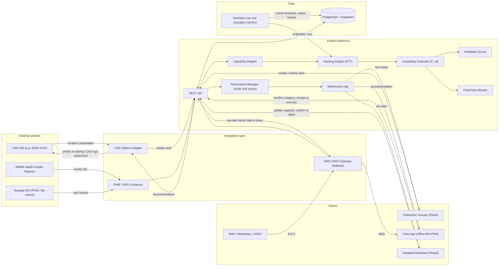
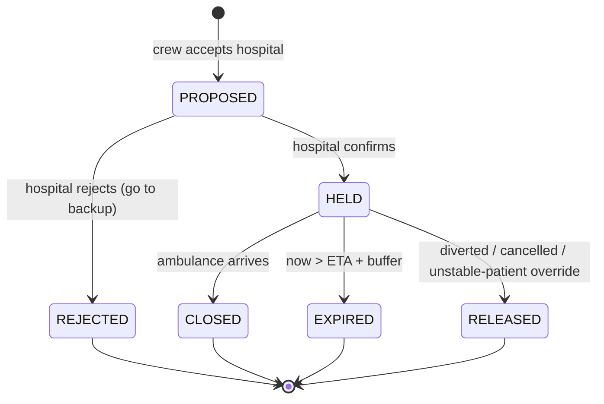
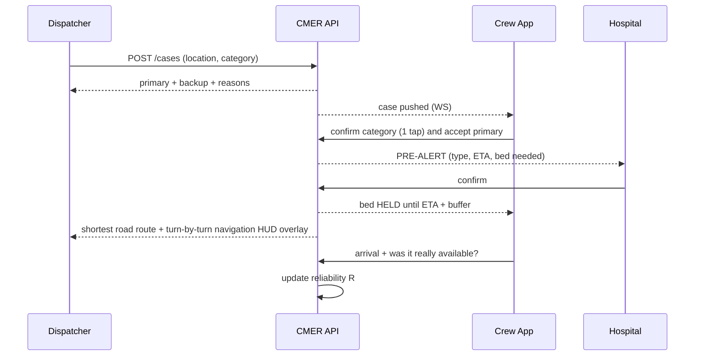
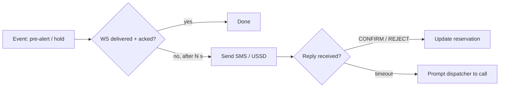

# Capability-Matched Emergency Referral (CMER)

**Taking the patient to the right hospital the first time.**

> 108 gets the ambulance to the patient. CMER helps get the patient to the right hospital the first time.

Seva First Innovation Challenge (Viksit Bharat 2047), Track A (Product / Technology).
Full problem statement, evidence and sources: [document.md](./document.md).

> **Status:** simulation-based prototype on synthetic data. This is decision support. The dispatcher and EMT make the final call.

---

## Table of contents

1. [What it does](#1-what-it-does)
2. [Tech stack](#2-tech-stack)
3. [Architecture](#3-architecture)
4. [System design](#4-system-design)
5. [Repository layout](#5-repository-layout)
6. [Build order](#6-build-order)
7. [9/10/26 prototype (inter-university round)](#7-91026-prototype-inter-university-round)
8. [Running locally](#8-running-locally)
9. [Safety and limitations](#9-safety-and-limitations)

---

## 1. What it does

When a 108 call comes in, normal dispatch continues as usual. CMER sits alongside it and:

1. Maps the emergency to the **capability needed** (for example, head injury → trauma + neurosurgery + ICU).
2. **Filters** out hospitals that cannot provide that care.
3. **Ranks** the remaining hospitals by **Expected Time to Treatment (ETT)**, not by distance.
4. Recommends a **primary** and a **backup** hospital, with the reasons and a confidence figure.
5. Sends the hospital a **pre-alert**. The hospital confirms, and a bed is **held** until the ambulance arrives or the hold expires.
6. Learns a **reliability score** for each hospital from what crews actually find when they arrive.

There are three user interfaces: **Dispatcher dashboard**, **Ambulance crew app**, **Hospital dashboard**.

---

## 2. Tech stack

| Layer | Choice | Why |
|---|---|---|
| Frontend | **React 19 + Vite** (JS/JSX), `react-router-dom` v7 | Fast to build, one codebase for all 3 UIs |
| Styling | Vanilla CSS, dark clinical theme, `lucide-react` icons | Full control, premium look |
| Maps | **Leaflet + react-leaflet** with OpenStreetMap tiles | Free, no API key |
| Charts | **Recharts** | Simulation and calibration charts |
| Crew app | Same React app, mobile-first route → **offline-first PWA** (service worker + IndexedDB cache, compressed payloads) | No native build; keeps working on rural corridors with patchy signal |
| Backend API | **Python 3.12 + FastAPI** | Async, WebSockets built in, same language as the maths |
| Real-time | FastAPI **WebSockets** (later: Supabase Realtime) | Pre-alerts and live bed updates |
| Ranking / probability | `numpy`, `scipy.stats` (Skellam / Poisson) | Exact bed-availability probability |
| Simulation | Python + **SimPy** (discrete-event) | Runs 200× baseline vs CMER comparisons |
| Database | **PostgreSQL (Supabase)** + SQLAlchemy 2.0 async | In-memory store for the prototype |
| Travel time | Haversine + speed + traffic noise → **OSRM** later | No external dependency for the demo |
| SMS / WhatsApp updates | Twilio sandbox (later phase) | Lets small facilities without IT report beds |
| SMS / USSD fallback | SMS gateway (Twilio / MSG91) + USSD aggregator | Pre-alerts and confirmations still go through when mobile data fails |
| Interoperability | **ABDM Health Facility Registry (HFR) IDs**, **HL7 FHIR R4** (`fhir.resources`) for `Organization` / `Location` / `HealthcareService` | Fits national digital public infrastructure; no duplicate hospital records |
| CAD integration | **Sidecar adapter** (FastAPI webhook / poller) next to the 108 operator's existing CAD | Reads incidents and sends back recommendations without changing core dispatch logs |
| Auth | Supabase Auth, role-based (dispatcher / crew / hospital) | Later phase |
| Testing / lint | `pytest -q`, `ruff`, `oxlint` | Quiet, quick checks |

---

## 3. Architecture



**Key principle:** the ranking engine is a **pure Python module** with no web code inside it. The API and the simulator both call the same function. That means the result you see in the demo is the same result being measured in the simulation.

---

## 4. System design

### 4.1 Data model (minimal, no patient data)

| Entity | Key fields |
|---|---|
| `hospital` | id, **hfr_id** (ABDM Health Facility Registry), name, tier (small / mid / tertiary), lat, lng, emergency_phone, sms_number, reliability `R` (default 0.8) |
| `capability` | hospital_id, code (`TRAUMA`, `NEURO`, `CARDIAC`, `OBSTETRIC`, `NICU`, `BURNS`, `PAEDS`, `ICU`, `BLOOD`, `CT`, `CATH_LAB`) |
| `ward_status` | hospital_id, ward (ICU, ER, OBS, NICU…), total_beds, free_beds, reported_at, source (dashboard / sms / fhir / api) |
| `specialist_shift` | hospital_id, specialty, on_duty (bool), shift_end |
| `hospital_rates` | hospital_id, ward, hour, discharge_rate `d`, admission_rate `a` |
| `er_load` | hospital_id, waiting_count, est_delay_min |
| `case` | id, **cad_incident_id** (nullable), lat, lng, category, severity, num_patients, status, created_at |
| `outbound_message` | id, case_id, channel (ws / sms / ussd), payload, status (queued / sent / acked), retries |
| `recommendation` | case_id, hospital_id, rank, ett, travel_time, er_delay, p_ok, reasons[] |
| `reservation` | id, case_id, hospital_id, ward, status, eta, expires_at |
| `arrival_feedback` | case_id, hospital_id, bed_ok, specialist_ok, equipment_ok, accepted, `match` |
| `override_log` | case_id, from_hospital, to_hospital, reason, actor |

### 4.2 Capability map

| Category | Required capabilities |
|---|---|
| Trauma / head injury | TRAUMA, NEURO, ICU, CT |
| Cardiac | CARDIAC, CATH_LAB, ICU |
| Stroke / neuro | NEURO, CT, ICU |
| Obstetric | OBSTETRIC, BLOOD, ICU or NICU |
| Paediatric | PAEDS, NICU / PICU |
| Burns | BURNS, ICU |
| General / uncertain | ER only (widest set) |

### 4.3 Ranking pipeline

```
case ─► capability_required(category)
     ─► filter hospitals (has all capabilities)
     ─► for each candidate h:
            travel_time(h)      haversine × road factor ÷ speed × traffic noise
            ER_delay(h)         from er_load
            P_ok(h)             Section 4.4
            reroute_penalty(h)  travel(h → nearest other capable) + handling delay
            ETT(h) = travel + ER_delay + (1 − P_ok) × reroute_penalty
     ─► sort by ETT ─► primary = #1, backup = #2
     ─► reasons[] (e.g. "Neurosurgeon on duty", "ICU 85% likely", "Data 42 min old: verify")
```

### 4.4 Availability probability (`P_ok`)

- `f0` is the last reported free beds. `t` is report age plus ETA, in minutes.
- Discharges are modelled as `Poisson(d·t)` and admissions as `Poisson(a·t)`, so `free(T) = f0 + Skellam(d·t, a·t)`.
- `P_ok = P(free(T) − held_beds − turnover_buffer ≥ 1)`, computed with `scipy.stats.skellam`.
- **Reliability widening:** when `R` is low, the estimate is blended toward a pessimistic prior: `P_ok' = R·P_ok + (1−R)·P_prior`.
- **Freshness bands:** Fresh (≤15 min) means the report is trusted. Aging (15–30 min) uses the full estimator. Stale (>30 min) uses the estimator and shows a **"Verify"** button. A stale hospital is never dropped.
- Specialists and equipment are a simple multiplier: `P_ok_total = P_bed × P_specialist × P_equipment`.

### 4.5 Reservation state machine



A `HELD` reservation counts in `held_beds`. This is how a second ambulance going to the same hospital sees a lower `P_ok`.

### 4.6 Reliability score

After arrival: `R_new = (1 − α)·R_old + α·match` with `α = 0.1`.
`match = 1` when the reported bed, specialist and equipment were really available.

### 4.7 API surface

| Method | Endpoint | Used by |
|---|---|---|
| `GET` | `/hospitals` | all |
| `POST` | `/cases` | dispatcher creates a case and gets the ranked list |
| `GET` | `/cases/{id}/recommendations` | dispatcher, crew |
| `PATCH` | `/cases/{id}/category` | crew confirms or changes category, which triggers a re-rank |
| `POST` | `/cases/{id}/accept` | crew accepts a hospital → `PROPOSED` |
| `POST` | `/cases/{id}/override` | crew override with a reason (logged) |
| `POST` | `/reservations/{id}/confirm` · `/reject` | hospital |
| `PATCH` | `/hospitals/{id}/status` | hospital updates beds, specialists, equipment |
| `POST` | `/hospitals/{id}/verify` | dispatcher one-tap verify (confirmed / unavailable) |
| `POST` | `/cases/{id}/arrival` | arrival feedback → reliability update |
| `POST` | `/sim/run` | run strategy comparison, returns metrics |
| `POST` | `/integrations/cad/incident` | CAD sidecar sends an incident → case + ranking |
| `GET` | `/integrations/cad/incident/{id}/recommendation` | CAD sidecar reads back the recommendation |
| `POST` | `/integrations/fhir/bundle` | hospital HIS pushes a FHIR bundle of bed/location status |
| `POST` | `/integrations/sms/inbound` | SMS / USSD replies (`"ICU 2"`, `"CONFIRM 4821"`) |
| `WS` | `/ws/{role}/{id}` | events: `case.created`, `prealert`, `reservation.updated`, `status.updated` |

### 4.8 End-to-end sequence



### 4.8.1 Road routing and shortest path navigation
- **Turn-by-turn routing:** When the dispatcher or crew taps **"Confirm & Start Navigation"**, the system queries the **OSRM / OpenStreetMap** road network engine for the shortest real-world driving corridor.
- **Dynamic route polyline:** Renders directly on the Leaflet console using Google Maps-style speed/traffic cyan and blue polylines (`Polyline`), with live ETA and distance calculations.
- **Pre-Alert linkage:** Starting navigation automatically transmits a high-priority pre-alert to the receiving hospital, initiating the 20-minute bed hold window.

### 4.9 Integration and interoperability

More detail in [document.md §15](./document.md).

- **ABDM alignment:** every hospital is identified by its **HFR ID**, so records are not duplicated. Capacity is shared as FHIR R4 resources (`Organization`, `Location` with operational status, `HealthcareService`). HIS-equipped hospitals push FHIR bundles. Everyone else uses the dashboard or SMS.
- **CAD sidecar:** CMER does not replace the operator's CAD. The adapter either receives a webhook or polls the CAD's incident feed. It creates a CMER case and writes the recommendation back to a companion overlay. Core dispatch logs are never modified. A swappable `CadAdapter` interface lets each vendor get its own implementation.
- **Offline-first crew app:** the PWA caches the hospital list, the last ranking and the case on the device. Actions taken offline go into an outbox and sync when the signal returns.
- **SMS / USSD fallback:** if a WebSocket message is not acknowledged within N seconds, `outbound_message` re-sends it by SMS. Short codes let the crew and hospitals reply (`CONFIRM 4821`, `REJECT 4821`) and the reply updates the same reservation state machine.



---

## 5. Repository layout

```
seva/
├── README.md
├── document.md                 # full proposal and evidence
├── backend/
│   ├── app/
│   │   ├── main.py             # FastAPI app, routes, WebSocket hub
│   │   ├── models.py           # Pydantic / SQLAlchemy models
│   │   ├── store.py            # in-memory store (prototype) → Postgres later
│   │   ├── engine/
│   │   │   ├── capability.py   # category → required capabilities
│   │   │   ├── ranking.py      # filter + ETT (pure functions)
│   │   │   ├── probability.py  # P_ok, freshness, reliability
│   │   │   └── reservations.py # hold / expiry state machine
│   │   ├── integrations/
│   │   │   ├── cad_adapter.py  # CadAdapter interface + mock CAD feed
│   │   │   ├── fhir.py         # FHIR R4 mapping, HFR IDs
│   │   │   └── messaging.py    # SMS / USSD gateway + fallback outbox
│   │   └── seed/city.py        # synthetic city: 15 hospitals
│   ├── sim/
│   │   ├── simulator.py        # SimPy discrete-event sim
│   │   └── strategies.py       # nearest, nearest-with-bed, CMER
│   └── tests/
└── frontend/
    └── src/
        ├── pages/Dispatcher.jsx
        ├── pages/Crew.jsx
        ├── pages/Hospital.jsx
        ├── pages/Simulation.jsx
        ├── components/          # MapView, HospitalCard, ConfidenceBar, FreshnessBadge
        └── index.css            # design tokens
```

---

## 6. Build order

The hardest part is the logic, so build it first, keep it as pure functions, and test it before adding any UI ("logic before shell").

| # | Phase | Deliverable | Done when |
|---|---|---|---|
| 0 | **Synthetic city** | `seed/city.py`: 15 hospitals (5 small, 6 mid, 4 tertiary) with real coordinates in one city, capabilities, wards, shifts, rates | JSON dump looks realistic |
| 1 | **Ranking engine** | `capability.py`, `ranking.py`: filter + ETT with a simple `P_ok = 1 if free>0 else 0.1` | `pytest` shows CMER picks differently from "nearest" |
| 2 | **Probability engine** | `probability.py`: Skellam `P_ok`, freshness bands, reliability blend | Stale and unreliable hospitals get a lower but non-zero `P_ok` |
| 3 | **API** | FastAPI routes in 4.7, in-memory store | `POST /cases` returns a ranked list with reasons |
| 4 | **Dispatcher dashboard** | Map, case form, ranked cards (ETT, confidence bar, freshness badge, reasons) | Click on map → see primary and backup |
| 5 | **Hospital dashboard + reservations** | Bed steppers, pre-alert toast, confirm / reject, hold countdown | Confirm turns the hold green; rejecting moves to the backup |
| 6 | **Real-time** | WebSocket hub pushes events to all 3 UIs | Two browser tabs update live |
| 7 | **Crew app** | Mobile view: 1-tap category confirm, accept / override with reason, call button, unstable-patient button | Override is logged and hold released |
| 7b | **CAD sidecar (mock)** | `CadAdapter` interface + a mock CAD feed posting incidents to `/integrations/cad/incident` | An incident from the mock CAD appears in the dispatcher overlay without manual entry |
| 8 | **Verification + reliability** | One-tap verify on stale hospitals; arrival feedback → `R` update | `R` visibly changes after a bad report |
| 9 | **Simulation + evaluation** | SimPy sim, 3 strategies, 200 runs each, robustness (100→30% reporting), calibration plot | Simulation page shows charts with error bars |
| 10 | **Persistence + auth** | Supabase Postgres + role-based auth | Data survives a restart |
| 11 | **Low-tech channels + fallback** | Twilio SMS / WhatsApp parser (`"ICU 2"`), WS → SMS / USSD fallback outbox, `CONFIRM/REJECT` codes | With the network blocked, a pre-alert still arrives by SMS and the reply updates the hold |
| 12 | **Offline-first PWA** | Service worker, IndexedDB cache, outbox sync, compressed payloads | Crew app works in airplane mode and syncs on reconnect |
| 13 | **ABDM / FHIR interoperability** | HFR IDs on hospitals, FHIR R4 export/import (`/integrations/fhir/bundle`) | A FHIR bundle updates bed counts; the hospital is resolved by HFR ID |
| 14 | **Hardening** | Sensitivity tests, OSRM routing, security review, deploy | Ready for the pilot pitch |

---

## 7. 9/10/26 prototype (inter-university round)

### 7.1 The situation

- **10–15 teams** demo. **Only the top 5** go on to register for the national Seva First challenge.
- Judges will see many slide decks and half-working apps. Most teams will show a "nearest hospital on a map" app or a chatbot.
- **To make the top 5:** show **one complete, live, end-to-end story** that makes the key idea obvious: *nearest is not the same as right*. Back it with a number.

> [!IMPORTANT]
> A full flow that works end to end will beat five half-built features. Build **phases 0–6 in a stripped-down form** plus **one comparison chart**. Skip everything else.

### 7.2 Scope for tomorrow

| Build ✅ (must have) | Fake or simplify 🟡 | Skip ❌ |
|---|---|---|
| Synthetic city: **12–15 hospitals** on a real city map | Travel time = haversine × 1.4 ÷ 30 km/h (no OSRM) | Login / auth |
| Capability filter + **ETT ranking** with reasons | `P_ok`: Skellam if time allows, otherwise `free/(free+held+1)` × freshness factor | Supabase / database (in-memory is fine) |
| **Dispatcher dashboard**: click map → case → primary + backup with ETT, confidence bar, freshness badge | Crew app = a **mobile-width page** with category + accept/override | SMS / WhatsApp |
| **Hospital dashboard**: bed +/− steppers, **pre-alert pop-up**, confirm/reject | Reliability `R`: pre-seeded values (one hospital "known unreliable") | Full SimPy simulation |
| **Live update** between tabs (WebSocket, or polling every 2 s) | Comparison chart: run a quick Python loop (≈500 random cases) **beforehand** and show a static Recharts bar chart | Calibration diagram, robustness sweep |
| **"Nearest vs CMER" toggle** on the dispatcher map | Verify button sets the data to "fresh" when clicked | Arrival feedback loop |
| | *(Optional, ~20 min)* **"Incoming from 108 CAD"** button that posts a mock incident to `/integrations/cad/incident`. Shows the sidecar idea live | Real FHIR / HFR, offline PWA, real SMS / USSD (show them on **one architecture slide** instead) |

### 7.3 Tonight's build plan (≈6–7 hours)

| Time | Task |
|---|---|
| 18:30 – 19:15 | Scaffold `backend/` (FastAPI) and `frontend/` (Vite React). Write `seed/city.py` with hospitals, capabilities, beds, report ages |
| 19:15 – 20:30 | `ranking.py` + `probability.py` + 3–4 pytest cases (head injury: nearest small clinic vs tertiary 4 km further) |
| 20:30 – 21:00 | API: `POST /cases`, `PATCH /hospitals/{id}/status`, `POST /cases/{id}/accept`, `POST /reservations/{id}/confirm`, WS or polling |
| 21:00 – 21:30 | 🍽️ Break |
| 21:30 – 23:00 | Dispatcher page: Leaflet map, hospital markers (colour = freshness), case form, ranked cards with reasons, "Nearest vs CMER" toggle |
| 23:00 – 00:00 | Hospital page: bed steppers, pre-alert toast with ETA, confirm/reject, hold countdown. Minimal crew page |
| 00:00 – 00:30 | Quick strategy comparison script → static chart (% reaching a capable hospital first time, average time to treatment) |
| 00:30 – 01:00 | Polish the dark theme, rehearse the demo twice, **record a backup screen video** in case the demo fails live |

### 7.4 Demo script (3–4 minutes)

1. **Hook (20 s):** "In Karnataka, 10–12% of patients reached a hospital that couldn't treat them (IIHMR). The 108 ambulance arrived on time, but went to the wrong hospital."
2. **Baseline (30 s):** Dispatcher creates a *severe head injury* case. Toggle **Nearest**: it picks a small clinic 1.2 km away with no neurosurgeon.
3. **CMER (45 s):** Toggle **CMER**: the tertiary hospital 4 km away is primary, with a backup. Read out the reasons: *"Neurosurgeon on duty · ICU 87% likely · ETT 19 min vs 41 min with a re-route."*
4. **Stale data (30 s):** One capable hospital shows **"Data 45 min old"**. It is still ranked, with lower confidence and a **Verify** button. Click it to show that one tap brings it back to fresh.
5. **Pre-alert (45 s):** Crew accepts → the hospital tab shows a **pop-up alert** → hospital confirms → **bed held, 18:00 countdown**. Then reduce ICU beds to 0 in the hospital tab and show the dispatcher re-ranking live.
6. **Evidence (20 s):** Show the chart: *"In 500 simulated cases, the share reaching a capable hospital first time went from X% (nearest) to Y% (CMER)."* Say clearly that this is synthetic data.
7. **Close (10 s):** "108 gets the ambulance to the patient. We get the patient to the right hospital the first time. Next step: a supervised pilot with 3–5 hospitals in one district."

### 7.5 What makes this top-5 material

- ✅ **Live, not slides.** Three role screens updating in real time.
- ✅ **A clear new idea.** Ranking by *expected time to treatment* with *probability* is something few or no other teams will have.
- ✅ **Handles messy reality.** Stale data, unreliable hospitals and the unstable-patient override show you understand the real 108 workflow.
- ✅ **A number.** Even a quick simulation chart beats claims with no figures.
- ✅ **Honesty.** Decision support only, synthetic data, a pilot pathway. Judges trust teams that state their limits.

### 7.6 Likely judge questions (prepare answers)

| Question | Answer |
|---|---|
| "Why would hospitals update data?" | Pre-alerts, fewer wrong arrivals, visibility to 108. The reliability score rewards accurate reporting. Delhi and Karnataka have already pushed for real-time bed reporting (see [document.md §8](./document.md)) |
| "What if the data is wrong?" | Freshness bands, reliability score, one-tap verify, a confirm-before-hold step, and the EMT can always override |
| "Does this replace 108?" | No. It is a layer on top of the existing dispatch process |
| "How is this different from COVID bed dashboards?" | Those showed counts. This ranks by capability + probability + travel time, and adds holds and pre-alerts |
| "Is it validated?" | Simulation only for now. Next is a supervised pilot run alongside 108, giving advice only |
| "Will 108 operators (e.g. EMRI) rewrite their CAD for you?" | They don't need to. A sidecar adapter reads incidents and returns recommendations through a companion overlay, and core dispatch logs stay untouched |
| "How does this fit national health infrastructure?" | Hospitals are keyed by ABDM HFR IDs, and capacity can be exchanged as FHIR R4 resources |
| "What about rural areas with no signal?" | Offline-first crew app with local cache. Pre-alerts and confirmations fall back to SMS / USSD |

---

## 8. Running locally

```powershell
# Backend
cd backend
python -m venv .venv
.\.venv\Scripts\activate
pip install fastapi uvicorn[standard] numpy scipy pydantic
uvicorn app.main:app --reload --port 8000

# Frontend (new terminal)
cd frontend
npm install
npm run dev   # http://localhost:5173
```

Open three tabs: `/dispatcher`, `/hospital/<id>`, `/crew/<caseId>` (use mobile view in DevTools for the crew page).

Checks: `pytest -q` · `ruff check --quiet` · `npx oxlint`

---

## 9. Safety and limitations

- Decision support only. The dispatcher and EMT keep authority over the destination.
- All results come from **synthetic data**. No claim of clinical effectiveness.
- Unstable-patient rule: the crew can always go to the nearest stabilising facility. The override is logged and the hold released.
- Real deployment needs a 108 operator / state partnership, hospital participation, security and privacy controls, and clinical validation.
